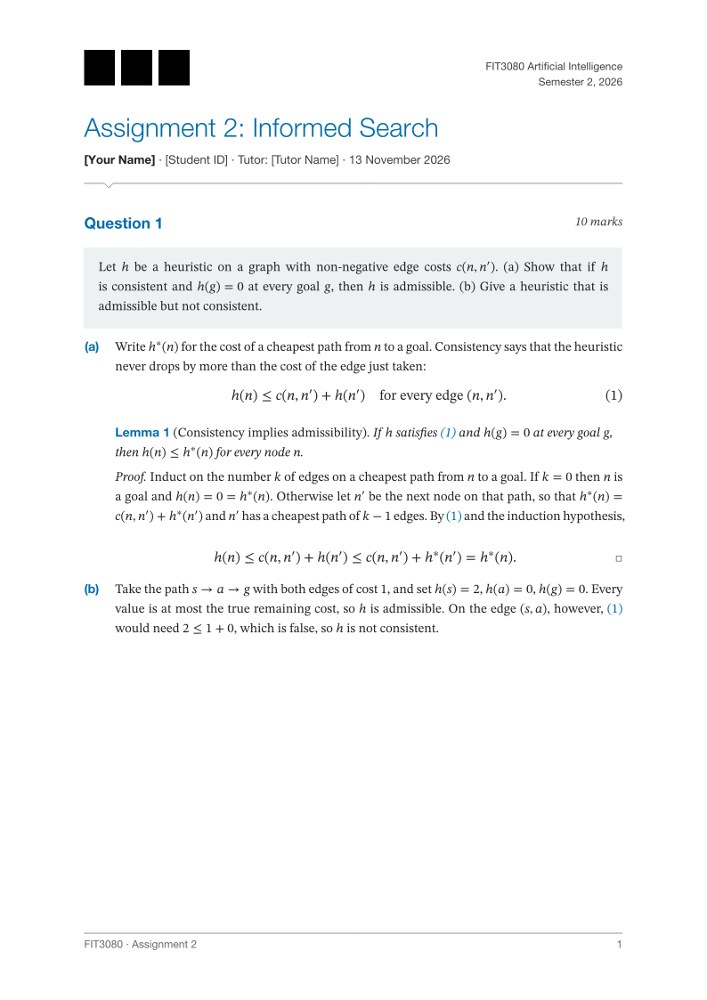
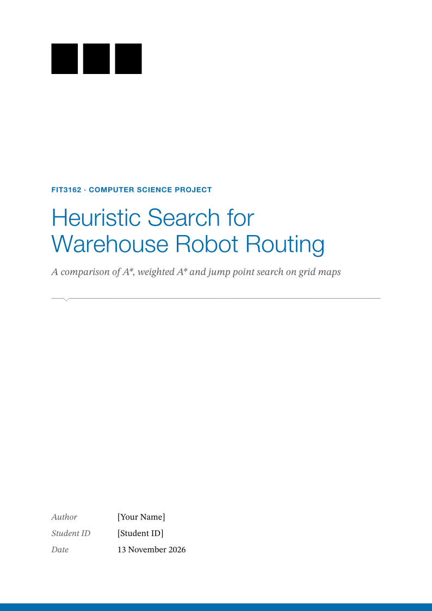
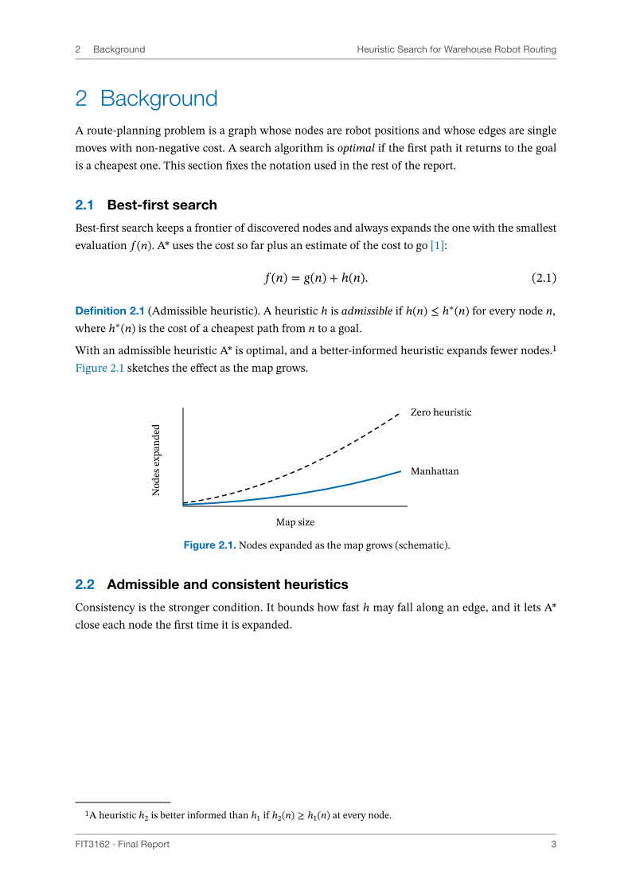

# Unofficial Monash Report

A Typst template package for STEM assignments and reports. One show rule sets
serif body text, restrained blue headings, running heads, academic tables,
numbered questions, and referenceable theorem environments. Requires Typst
0.15.0 or newer.

**Unofficial:** this package is not affiliated with or endorsed by Monash
University. No Monash logo, crest, or wordmark is included. Obtain a logo
yourself, ensure you have the right to use it, and supply it with `logo:`.

| Assignment | Report cover | Report body |
| --- | --- | --- |
|  |  |  |

The previews contain no institutional mark. All names, IDs, measurements in
example result tables, and bibliographic entries are placeholders.

## Quick start

After the package is available on Universe, create the assignment starter:

```sh
typst init @preview/unofficial-monash-report:0.1.0 my-assignment
typst compile my-assignment/main.typ
```

A minimal assignment:

```typst
#import "@preview/unofficial-monash-report:0.1.0": *
#show: assignment.with(title: [Assignment Title])
#question(marks: 10)[State the question here.]
+ Write the first part of the answer.
+ Write the second part.
```

For a report, initialise the same starter and replace `main.typ`:

```sh
typst init @preview/unofficial-monash-report:0.1.0 my-report
```

```typst
#import "@preview/unofficial-monash-report:0.1.0": *
#show: report.with(
  title: [Report Title],
  abstract: [Summarise the purpose, method and main result.],
  keywords: ("first keyword", "second keyword"),
)
= Introduction
Start the report here.
== Setting
Describe the setting.
```

Before publication, use the temporary local package path created by
`scripts/check.sh`; no global package installation is required for development.
The complete examples reproduce the supplied mock's assignment and report
content. Unspecified report pages contain editable placeholders.

## Adding your logo

Obtain the approved file from Monash's [official logo resources](https://www.monash.edu/brandbook/brand-elements/our-logo)
using your institutional access where required. Put it in `assets/logo.svg`
next to your document. Add `logo: image("assets/logo.svg"),` to its show rule:

```typst
#import "@preview/unofficial-monash-report:0.1.0": *
#show: assignment.with(
  title: [Assignment Title],
  logo: image("assets/logo.svg"),
)
Your answer.
```

Use the supplied logo on white only in this template. Do not recolour,
stretch, or crop it. Preserve the official clear space, at least the height
of the letter M in the logo, and check the minimum size for your chosen
format in the linked resources. The package scales content proportionally
to 30pt on assignments and 42pt on report covers; include any required clear
space in your asset. The layout is complete when `logo: none` is used.
Tests use only an image of three plain rectangles.

## Arguments

All arguments are optional except `title`. Text fields accept strings or
content; `none` and empty text suppress a field. Bad types and unknown
arguments panic with the argument name. The document body follows the show
rule as ordinary Typst markup.

### Shared options

These apply to both `assignment` and `report`.

| Argument | Default | Type / effect |
| --- | --- | --- |
| `title` | required | String or content; document title. |
| `author` | `none` | String or content; single author. |
| `student-id` | `none` | String or content; placeholder ID in examples. |
| `unit` | `none` | String or content; assignment's top-right unit, report's blue uppercase unit line. |
| `semester` | `none` | String or content; top-right line. |
| `date` | `datetime.today()` | Datetime, content, or `none`; dates display as day, full month and year. |
| `short-title` | `auto` | String, content or `none`; `auto` joins the first word of `unit` and the title before its first colon with ` · `. Used in the footer and assignment header. |
| `logo` | `none` | Content, normally `image(...)`; proportional scaling, no recolouring. |
| `font` | `auto` | Body font name or non-empty array of names. |
| `heading-font` | `auto` | Heading and page-furniture font name or array. |
| `math-font` | `auto` | Math font name or array. |
| `code-font` | `auto` | Code font name or array. |
| `font-size` | `11pt` | Positive absolute length; body size. |
| `accent` | `monash-blue` | Colour; replaces blue throughout the document. |
| `paper` | `"a4"` | `a0`–`a6`, `us-letter`, `us-legal`, or `us-tabloid`. The design is sized for A4. |
| `lang` | `"en"` | Non-empty language string for text and hyphenation. |

### Assignment options

Use `#show: assignment.with(...)` with the shared options and:

| Argument | Default | Type / effect |
| --- | --- | --- |
| `tutor` | `none` | String or content; adds `Tutor: ...` in the byline. |
| `info` | `()` | Array of content; extra byline items. Empty items are omitted, without separators. |

The first page has a title block and footer. Subsequent pages add the short
title and author/ID above the running-head rule. Pages start at 1.

### Report options

Use `#show: report.with(...)` with the shared options and:

| Argument | Default | Type / effect |
| --- | --- | --- |
| `subtitle` | `none` | String or content; italic subtitle below the cover title. |
| `doc-type` | `none` | String or content; cover text below the notched rule. |
| `authors` | `()` | Array of dictionaries with `name`, optional `student-id`, optional `contribution`. Replaces the single-author fields. Contribution column appears only if at least one value is set. |
| `supervisor` | `none` | String or content; cover row. |
| `word-count` | `none` | Non-negative integer, string or content; cover row. |
| `faculty` | `none` | String or content; top-right cover line. |
| `info` | `()` | Array of `(label, value)` pairs; extra cover rows after the standard fields. |
| `abstract` | `none` | String or content; indented front-matter abstract. |
| `keywords` | `()` | Array of strings or content; joined with commas after `Keywords:`. |
| `outline` | `true` | Boolean; show a two-level table of contents. |

The cover is unnumbered. Abstract and contents share a page when they fit;
front matter starts at roman i. The body restarts at arabic 1. Level-one
headings do not force a page break. The running head shows the current
chapter and report title; the footer shows `short-title` and the page.

A group report:

```typst
#import "@preview/unofficial-monash-report:0.1.0": *
#show: report.with(
  title: [Group Report], outline: false, date: none,
  authors: (
    (name: [Author 1], student-id: [Student ID], contribution: [Method]),
    (name: [Author 2], student-id: [Student ID]),
    (name: [Author 3], student-id: [Student ID], contribution: [Results]),
  ),
)
= Introduction
Your group's report.
```

## Components

### Questions and answer parts

`question(marks: none, title: none, number: auto)[statement]` steps its own
counter. A positive integer `number` overrides it; following questions
continue from that value. Numeric marks gain the word “marks”; content and
strings are printed as supplied. Omit the statement to get a heading only.
A label after the call makes `@label` print “Question N”.

Ordinary `+` lists give `(a)`, `(b)`, then nested `(i)`, `(ii)`.

```typst
#import "@preview/unofficial-monash-report:0.1.0": *
#show: assignment.with(title: [Questions], date: none)
#question(marks: 5, title: [A short proof])[Show the claim.] <q-claim>
+ First answer part.
  + First nested part.
  + Second nested part.
+ Second answer part.
#question(number: 5)
See @q-claim.
```

### Theorems and proof

`theorem`, `lemma`, `proposition`, `corollary`, `definition`, `example`, and
`remark` take a body, or a positional title followed by a body. All seven
share one counter. The first four have italic bodies; the other three are
upright. Labels and references use the correct environment name.
`proof[body]` begins with italic “Proof.” and ends with a square at the right,
including when the final item is a display equation.

```typst
#import "@preview/unofficial-monash-report:0.1.0": *
#show: assignment.with(title: [A Result], date: none)
#lemma[Non-negativity][For real $x$, $x^2 >= 0$.] <lem-square>
#proof[Every real square is non-negative. $ x^2 >= 0 $]
See @lem-square.
```

### Figures, tables, listings, equations and references

Use native `figure`, `table`, `raw` and display math. Tables have three
horizontal rules and captions above. Other figures and listings have
captions below. Use `table.header` for the first row. Figures, tables,
listings and equations each have their own counter. The theorem-like
counter is separate and shared across environment kinds. Numbering is
continuous in assignments and `chapter.n` in reports, with each counter
reset at a level-one heading. Links and references use the accent colour.

```typst
#import "@preview/unofficial-monash-report:0.1.0": *
#show: report.with(title: [Native Components], outline: false, date: none)
= Results
#figure(
  table(columns: 2, table.header[Method][Count], [Example], [12]),
  caption: [A three-line table.],
) <tab-results>
#figure([Figure content], caption: [A figure.]) <fig-result>
#figure(raw("def identity(x):\n    return x", lang: "python", block: true),
  caption: [An example listing.]) <code-example>
$ f(n) = g(n) + h(n) $ <eq-score>
See @tab-results, @fig-result, @code-example and @eq-score.
```

### Code

Fenced code blocks have black top and bottom rules, grey line numbers,
blue keywords and grey comments. Inline code is undecorated. Listing
captions require the native `figure(raw(...), caption: ...)` wrapper shown
above. The package supplies its own syntax theme; it has no package dependency.

### Appendix

Wrap the report's appendix chapters in `appendix[...]` (or use it as a show
rule for the remaining content). Chapter labels become A, B, and so on;
subsections and component numbers use A.1, A.2, etc. Assignment use panics.

```typst
#import "@preview/unofficial-monash-report:0.1.0": *
#show: report.with(title: [Report with Appendix], outline: false, date: none)
= Main text
A result.
#appendix[
  = Additional experiments
  $ x = y $
  #lemma[An appendix result.]
]
```

### Design tokens

The public colours are `monash-blue`, `monash-black`, `monash-grey-dark`,
`monash-grey`, `monash-grey-mid`, `monash-grey-soft`, and `monash-grey-light`.
The exported names are `assignment`, `report`, `question`, `theorem`, `lemma`,
`proposition`, `corollary`, `definition`, `example`, `remark`, `proof`, `appendix`,
the `monash-fonts` dictionary, and the seven colours listed above. Importing
`lib.typ` changes no document settings.
Rules placed after the document's `#show:` can override the default styles.

## Fonts

Opt into all four preferred stacks with
`report.with(..monash-fonts, title: [Report Title])`, or spread `..monash-fonts`
into `assignment.with(...)`. **Typst warns about any listed family that is
not installed.** This explicit opt-in passes every family through unchanged;
it does not filter missing fonts.

The exported `monash-fonts` dictionary contains these preferred stacks under
`font`, `heading-font`, `math-font`, and `code-font`:

| Use | Ordered font families |
| --- | --- |
| Body | STIX Two Text, Libertinus Serif |
| Math | STIX Two Math, New Computer Modern Math |
| Headings and page furniture | Helvetica Neue, Helvetica, Arial, Liberation Sans, Libertinus Serif |
| Code | JetBrains Mono, DejaVu Sans Mono |

Typst 0.15.1 warns about every unavailable family in an explicit fallback
list and exposes no font-enumeration API inside a document. To keep normal
compilation warning-free, `auto` uses compiler-embedded fonts unless a
font inventory is supplied. The fallback is Libertinus Serif for body and
headings, New Computer Modern Math for math, and DejaVu Sans Mono for code.
For `auto`, the preferred lists are filtered against the supplied inventory,
in order. Explicit font arguments, including `..monash-fonts`, bypass this
filter. No compiler diagnostics are suppressed.

`scripts/check.sh` supplies the actual inventory from `typst fonts`. For the
same preferred font selection in your own project:

```sh
typst compile --input "monash-fonts=$(typst fonts | tr '\n' '|')" main.typ
```

In the Typst web app, or when you know which fonts are installed, override
font families explicitly. Explicit names are passed through unchanged,
so Typst will warn if you choose an unavailable font. This portable example
uses embedded families:

```typst
#import "@preview/unofficial-monash-report:0.1.0": *
#show: assignment.with(
  title: [Font Overrides],
  font: ("Libertinus Serif",),
  heading-font: "Libertinus Serif",
  math-font: "New Computer Modern Math",
  code-font: "DejaVu Sans Mono",
)
Text and $x^2$.
```

## Design notes

The supplied specification fixes `monash-blue` at `#006CAB`, with its
specified black and grey palette. These values are retained for consistency
with that brief. The [current published Monash palette](https://www.monash.edu/brandbook/brand-elements/colours)
uses `#006DAE` and different greys; this package does not claim to reproduce
the current brand guidelines. Its serif text, plain theorems, justified
paragraphs and three-line tables follow academic convention. The small
notch appears only under the assignment title and report cover title.

The authoritative requirements and five HTML mocks remain in `docs/spec/`.
Where their CSS conflicts with section 4, the section 4 sizes and numbering
rules take precedence. In particular, combined abstract/contents start at i,
although the mock footer shows ii. Fonts can change line wrapping.

## Development

```sh
scripts/check.sh
scripts/check.sh --ignore-system-fonts
scripts/check.sh --thumbnail
```

Both CI jobs use Typst 0.15.1. The script enforces a 100-character line limit
in `lib.typ`, `src/`, `tests/`, `examples/`, and `template/`, plus fewer than
300 lines per file under `src/`. It compiles every document in `tests/`,
`examples/`, and `template/`, checks invalid-argument panics, chapter and page
numbering, extracts and compiles all Typst samples from this README, and
compiles a fresh `typst init`. `--thumbnail` also regenerates the three README
previews and thumbnail. Generated PDFs, PNGs and test projects stay in
ignored `build/`; the README previews and Universe thumbnail are tracked.
